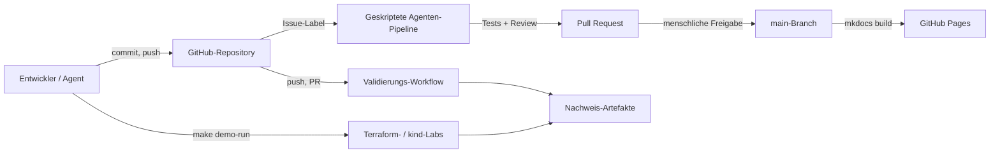
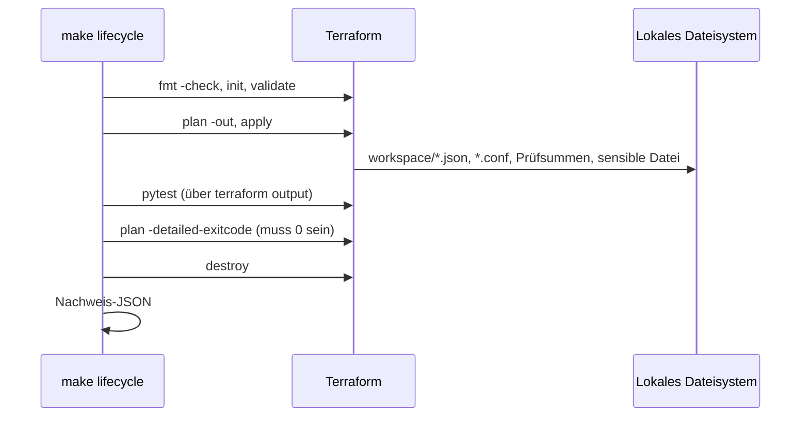
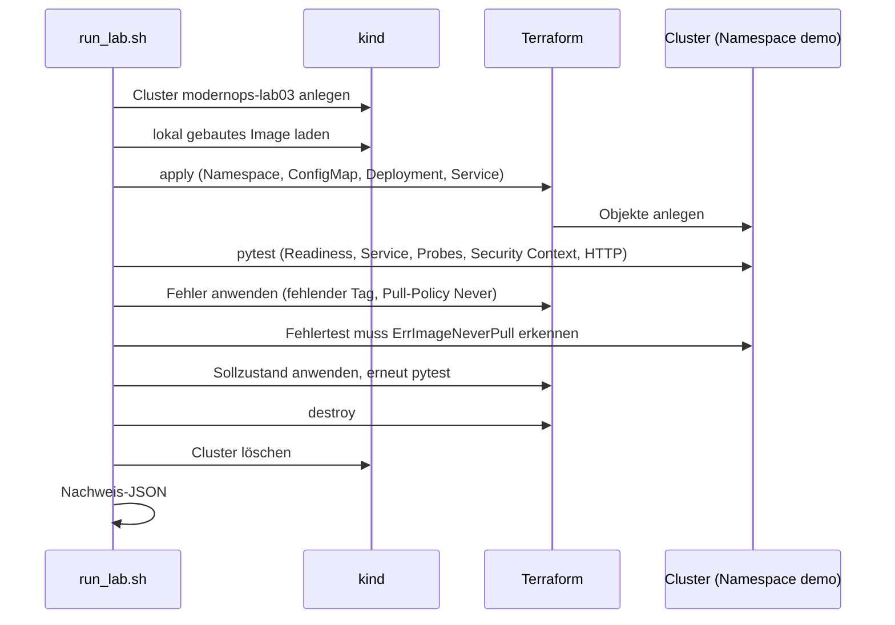
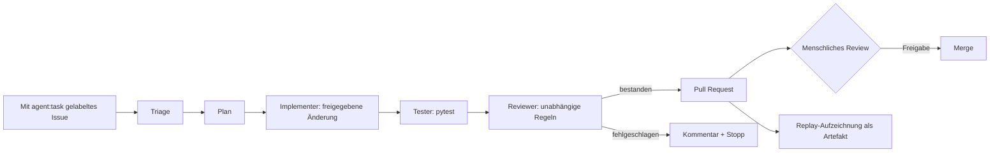

# Architektur

**Deutsch** | [English](ARCHITECTURE.md)

ModernOps Showcase ist eine **Referenzplattform**, kein Produkt: ein Repository
mit kleinen, reproduzierbaren Engineering-Szenarien und der Automatisierung
darum herum. Dieses Dokument erklärt, wie die Teile zusammenpassen, was wo läuft
und welche Teile bewusst fehlen.

## 1. Ziele und Nicht-Ziele

Ziele: echte Infrastrukturautomatisierung, echte Kubernetes-Workloads,
messbare Ergebnisse (Nachweise), moderne CI, klare Trennung von aufgezeichneten
und Live-Läufen.

Nicht-Ziele (MVP): kein SaaS, keine Mandantenfähigkeit, keine
Produktions-Workloads, keine dauerhaft laufende Cloud-Plattform, keine
automatischen Merges, keine Betreiber-API-Schlüssel für Besucher, keine
GPU-Anforderung.

## 2. Ausführungsmodell

| Komponente | Läuft auf | Lebensdauer | Kosten |
| --- | --- | --- | --- |
| Website | GitHub Pages | dauerhaft, statisch | kostenlos |
| Repository, Issues, PRs | GitHub | dauerhaft | kostenlos |
| Validierungs- und Demo-Workflows | GitHub Actions, Standard-Runner | pro Lauf | kostenlos für öffentliche Repos |
| Terraform-Lab | lokale Maschine oder Actions | Sekunden | kostenlos (lokaler Provider) |
| Kubernetes-Lab | lokales Docker + kind, oder Actions | Minuten | kostenlos |
| Agentic-Pipeline | GitHub Actions | pro Issue/Lauf | kostenlos (kein LLM) |
| AWS-Demos | *nicht implementiert* | -- | würde Geld kosten, daher deaktiviert |

Eine zentrale Designregel: **GitHub Pages führt nie etwas aus.** Es liefert nur
die gebaute statische Seite aus. Alles Dynamische passiert in Actions oder auf
der Entwicklermaschine.



## 3. Komponentensicht

```text
modern-ops-showcase/
├── labs/
│   ├── 01-terraform-lifecycle/   Terraform-Modul, lokaler State, Lifecycle-Skript, pytest
│   └── 03-kubernetes-platform/   kind-Konfiguration, App-Image, Terraform-K8s-Ressourcen, pytest
├── agents/                       Triage, Planner, Implementer, Tester, Reviewer (regelbasiert)
├── replay/                       Schema, Szenario, Aufzeichnungen echter Läufe
├── evidence/                     Schema + echte Beispielergebnisse
├── website/                      MkDocs-Material-Eingabe für GitHub Pages
├── docs/                         Erste Schritte, Runbook, Technologiematrix, ADRs
└── .github/                      Workflows, Issue-Formulare
```

## 4. Lab-Ablauf: Terraform (Lab 01)



## 5. Lab-Ablauf: Kubernetes (Lab 03)



Cluster-Erzeugung und Ressourcen-Provisionierung sind bewusst getrennt
([ADR 0005](docs/decisions/0005-cluster-creation-separate-from-terraform.de.md)).

## 6. Agentic-Pipeline



Die Pipeline ist deterministisch und enthält **kein LLM**. Sie demonstriert die
Orchestrierungsform (Triage, begrenzter Plan, begrenzte Änderung, Tests,
unabhängiges Review, PR, menschliche Freigabe) und ist ehrlich als geskriptet
gekennzeichnet. Siehe [docs/AGENT_WORKFLOW.de.md](docs/AGENT_WORKFLOW.de.md) und
[ADR 0008](docs/decisions/0008-agentic-orchestration-path.de.md).

## 7. Nachweismodell

Jeder Demo-Lauf erzeugt ein JSON-Dokument mit `scenario_id`, `execution_mode`
(`local` oder `live-ci`), `status`, Zeitstempeln, `commit`, `checks[]`,
`artifacts[]` und `limitations[]`. Schema:
`evidence/schema/scenario-result.schema.json`. Beispiele: `evidence/examples/`.
Artefakte aus Actions werden hochgeladen, nicht committet; committete Beispiele
sind echte Läufe und mit ihrem Commit gekennzeichnet.

## 8. Daten- und Vertrauensgrenzen

- Issue-Text von GitHub ist **unvertrauenswürdige Eingabe**: Die Pipeline
  validiert ihn, interpoliert ihn nie in Shell-Befehle und schreibt nur nach
  `evidence/agent-runs/`.
- Workflows, die bei einem `pull_request` aus Forks laufen, erhalten keine
  Secrets und haben Nur-Lese-Token.
- Das Kubernetes-Lab zieht nie aus einer Registry: Das Image ist lokal und wird
  in kind geladen, es sind also keine Credentials und kein öffentlicher Push
  beteiligt.
- Der Website-Build liest nur Repository-Dateien; zur Laufzeit gibt es keine
  entfernten Daten.

## 9. Entscheidungen

Alle Architekturentscheidungen sind in [docs/decisions/](docs/decisions/)
dokumentiert. Besonders relevant: ein einziges Repository, Hosting über GitHub
Pages, Actions als Ausführungsschicht, kind-Cluster, Trennung von Cluster und
Ressourcen, Replay als Standardmodus, BYOK für künftige Live-Läufe, geskriptete
Orchestrierung für das MVP, MkDocs Material als Website-Framework.

## 10. Bekannte Lücken (ehrliche Liste)

- Labs 02, 04--09 und die KI-Infrastruktur sind entworfen, aber **nicht
  implementiert**.
- Die Agentic-Pipeline ist geskriptet; es gibt keine LLM-Integration. Der
  Live-Modus ist nur dokumentiert.
- Der Terraform-State liegt lokal, ohne Remote-Backend oder Locking (ein
  späteres Lab).
- Es gibt noch keinen Observability-Stack (Prometheus/Grafana ist die nächste
  Phase).
- Die Entscheidung zum AWS-Emulator ist nicht getroffen; nichts im Umfeld von
  AWS läuft.

---

*Deutsche Fassung; maßgeblich ist die englische Originalfassung. Die Übersetzung kann hinter der englischen Version zurückliegen.*
