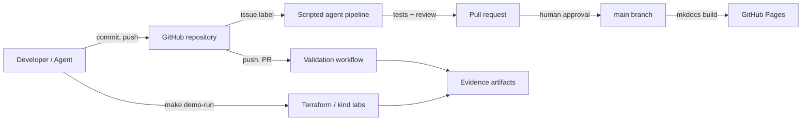
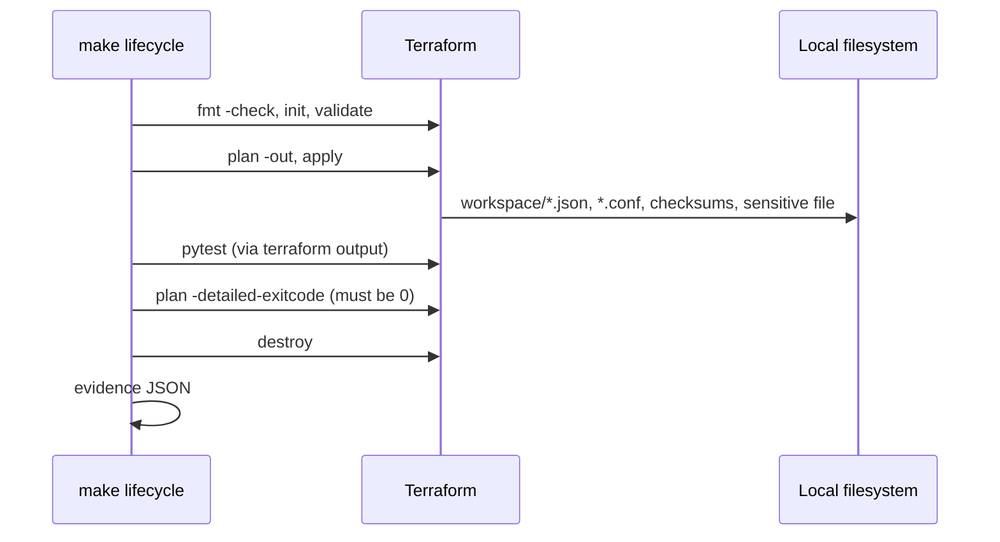
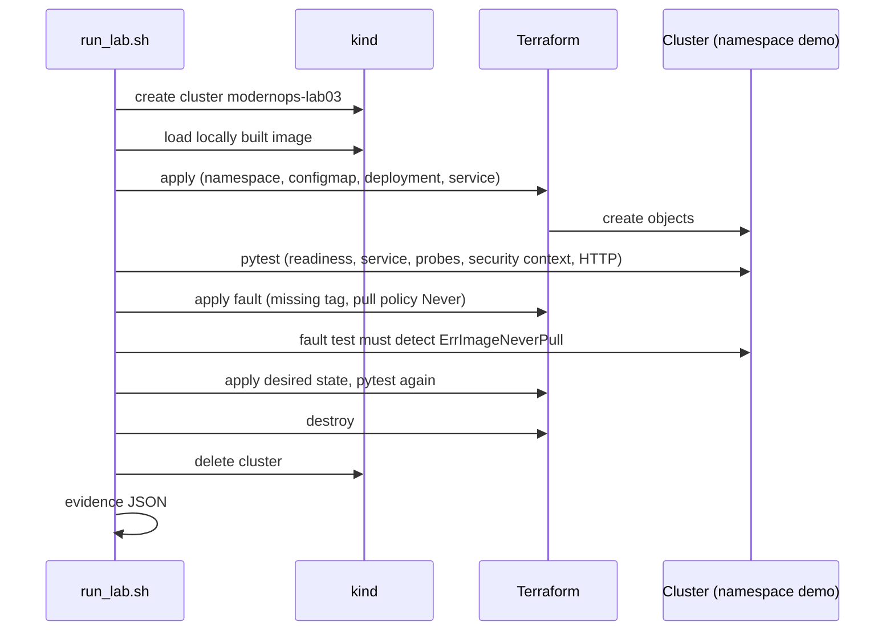
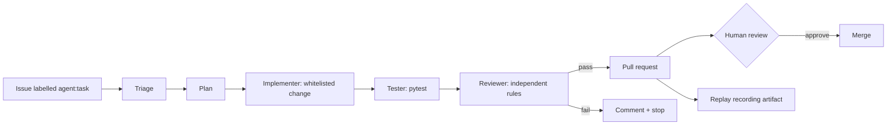

# Architecture

ModernOps Showcase is a **reference platform**, not a product: a repository of
small, reproducible engineering scenarios plus the automation around them. This
document explains how the pieces fit together, what runs where, and which parts
are deliberately absent.

## 1. Goals and non-goals

Goals: real infrastructure automation, real Kubernetes workloads, measurable
results (evidence), modern CI, clear separation of recorded vs. live runs.

Non-goals (MVP): no SaaS, no multi-tenancy, no production workloads, no cloud
platform running permanently, no automatic merges, no operator API keys exposed
to visitors, no GPU requirement.

## 2. Execution model

| Component | Runs on | Lifetime | Cost |
| --- | --- | --- | --- |
| Website | GitHub Pages | persistent, static | free |
| Repository, issues, PRs | GitHub | persistent | free |
| Validation and demo workflows | GitHub Actions, standard runners | per run | free for public repos |
| Terraform lab | local machine or Actions | seconds | free (local provider) |
| Kubernetes lab | local Docker + kind, or Actions | minutes | free |
| Agentic pipeline | GitHub Actions | per issue/run | free (no LLM) |
| AWS demos | *not implemented* | -- | would cost money, therefore disabled |

A key design rule: **GitHub Pages never executes anything.** It only serves the
built static site. Everything dynamic happens in Actions or on the developer
machine.



## 3. Component view

```text
modern-ops-showcase/
├── labs/
│   ├── 01-terraform-lifecycle/   Terraform module, local state, lifecycle script, pytest
│   └── 03-kubernetes-platform/   kind config, app image, Terraform K8s resources, pytest
├── agents/                       triage, planner, implementer, tester, reviewer (rule-based)
├── replay/                       schema, scenario, recordings of real runs
├── evidence/                     schema + real example results
├── website/                      MkDocs Material input for GitHub Pages
├── docs/                         getting started, runbook, technology matrix, ADRs
└── .github/                      workflows, issue forms
```

## 4. Lab flow: Terraform (Lab 01)



## 5. Lab flow: Kubernetes (Lab 03)



Cluster creation and resource provisioning are separate by design
([ADR 0005](docs/decisions/0005-cluster-creation-separate-from-terraform.md)).

## 6. Agentic pipeline



The pipeline is deterministic and contains **no LLM**. It demonstrates the
orchestration shape (triage, bounded plan, bounded change, tests, independent
review, PR, human approval) and is honestly labelled as scripted. See
[docs/AGENT_WORKFLOW.md](docs/AGENT_WORKFLOW.md) and
[ADR 0008](docs/decisions/0008-agentic-orchestration-path.md).

## 7. Evidence model

Every demo run produces a JSON document with `scenario_id`, `execution_mode`
(`local` or `live-ci`), `status`, timestamps, `commit`, `checks[]`, `artifacts[]`
and `limitations[]`. Schema: `evidence/schema/scenario-result.schema.json`.
Examples: `evidence/examples/`. Artifacts from Actions are uploaded, not
committed; committed examples are real runs and are labelled with their commit.

## 8. Data and trust boundaries

- GitHub issue text is **untrusted input**: the pipeline validates it, never
  interpolates it into shell commands, and only writes to `evidence/agent-runs/`.
- Workflows running on `pull_request` from forks receive no secrets and have
  read-only tokens.
- The Kubernetes lab never pulls from a registry: the image is local and loaded
  into kind, so no credentials and no public push are involved.
- The website build consumes only repository files; no remote data at runtime.

## 9. Decisions

All architectural decisions are recorded in [docs/decisions/](docs/decisions/).
Notable ones: single repository, GitHub Pages hosting, Actions as the execution
layer, kind clusters, cluster/resource split, replay as default mode, BYOK for
future live runs, scripted orchestration for the MVP, MkDocs Material as the
site framework.

## 10. Known gaps (honest list)

- Labs 02, 04--09 and AI infrastructure are designed but **not implemented**.
- The agentic pipeline is scripted; no LLM integration exists. Live mode is
  documented only.
- Terraform state is local with no remote backend or locking (a later lab).
- No observability stack yet (Prometheus/Grafana is the next phase).
- The AWS emulator decision is not made; nothing AWS-related runs.
