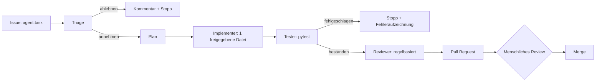

# Agentic Engineering

GitHub-Issues sind die Aufgabenquelle. Eine Pipeline macht aus einem Issue einen
geprüften Pull Request -- und ein Mensch entscheidet über den Merge.

!!! warning "Kein LLM in dieser Pipeline"
    Die Pipeline ist **geskriptet und deterministisch**. Sie implementiert die
    Orchestrierungsform (Triage, Plan, begrenzte Änderung, Tests, unabhängiges
    Review, PR, menschliches Gate), enthält aber kein Modell und keinen
    API-Schlüssel. Jedes geschriebene Artefakt sagt das. Live-KI-Läufe sind nur
    als BYOK-Design dokumentiert.

## Ablauf

## Schutzmechanismen

| Risiko | Kontrolle |
| --- | --- |
| unvertrauenswürdiger Issue-Text | von Python geparst, nie ausgeführt, gefährliche Muster abgelehnt |
| Ausweitung des Umfangs | Whitelist: nur `evidence/agent-runs/`, `replay/recordings/` |
| Secrets | keine nötig; nur das automatische `GITHUB_TOKEN` |
| Auto-Merge | nicht implementiert; `main` ist geschützt |
| Laufzeit | Workflow-Timeout, begrenzte Plan-Limits |
| Ehrlichkeit | Artefakte tragen `kind: scripted-pipeline`, `llm: false` |

## Erster echter Lauf

Die Pipeline lief für Issue #1 und öffnete [Pull Request #2](https://github.com/tatics-ug/modern-ops-showcase/pull/2) mit drei
erzeugten Dateien (Artefakt, Lauf-Aufzeichnung, Replay-Aufzeichnung). Alle Rollen
hatten Erfolg: Triage nahm an, Plan wurde abgeleitet, Implementer schrieb eine
Datei, Tests grün, Review freigegeben. Der Pull Request ist offen und wartet auf
menschliches Review -- die Pipeline merged nie.

Workflow-Lauf: [43255005540](https://github.com/tatics-ug/modern-ops-showcase/actions/runs/43255005540).

## Replay

Aufzeichnungen echter Läufe liegen in `replay/recordings/` und folgen
`replay/schema/recording.schema.json`: geordnete Ereignisse, Plan, Änderungen,
Tests, Review und PR-Metadaten. Eine Aufzeichnung wird nie erfunden.

## Live-Modus (nicht implementiert)

Ein BYOK-Design existiert in ADR 0007: vom Besucher bereitgestellter Schlüssel,
nur manuell auslösbar, kein Betreiber-Schlüssel, sichtbare Kosten. Es bleibt
deaktiviert, bis es sicher ausgeliefert werden kann.

---

*Deutsche Fassung; maßgeblich ist die englische Originalfassung. Die Übersetzung kann hinter der englischen Version zurückliegen.*
