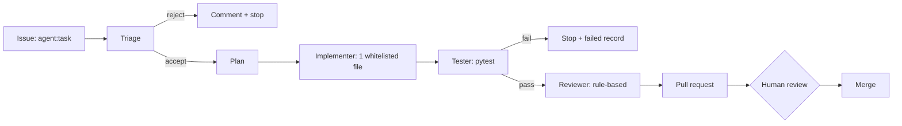

# Agentic Engineering

GitHub issues are the task source. A pipeline turns an issue into a reviewed
pull request -- and a human decides about the merge.

!!! warning "No LLM in this pipeline"
    The pipeline is **scripted and deterministic**. It implements the
    orchestration shape (triage, plan, bounded change, tests, independent
    review, PR, human gate) but contains no model and no API key. Every artefact
    it writes says so. Live AI runs are documented as a BYOK design only.

## Flow

## Guard rails

| Risk | Control |
| --- | --- |
| untrusted issue text | parsed by Python, never executed, dangerous patterns rejected |
| scope creep | whitelist: `evidence/agent-runs/`, `replay/recordings/` only |
| secrets | none needed; only the automatic `GITHUB_TOKEN` |
| auto-merge | not implemented; `main` is protected |
| runtime | workflow timeout, bounded plan limits |
| honesty | artefacts carry `kind: scripted-pipeline`, `llm: false` |

## First real run

The pipeline ran for issue #1 and opened [pull request #2](https://github.com/tatics-ug/modern-ops-showcase/pull/2) with three
generated files (artefact, run record, replay recording). All roles passed:
triage accepted, plan derived, implementer wrote one file, tests green, review
approved. The pull request is open and waits for human review -- the pipeline
never merges.

Workflow run: [43255005540](https://github.com/tatics-ug/modern-ops-showcase/actions/runs/43255005540).

## Replay

Recordings of real runs live in `replay/recordings/` and follow
`replay/schema/recording.schema.json`: ordered events, plan, changes, tests,
review and PR metadata. A recording is never fabricated.

## Live mode (not implemented)

A BYOK design exists in ADR 0007: visitor-supplied key, manual trigger only, no
operator key, costs visible. It is disabled until it can be shipped safely.
