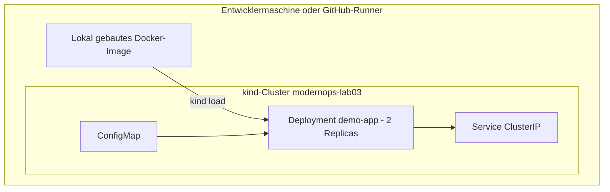

# Lab 03 -- Kubernetes-Anwendungsplattform

Status: `validated` -- vollständiger Lebenszyklus im Workflow `demo-kubernetes` ausgeführt ([Lauf](https://github.com/tatics-ug/modern-ops-showcase/actions/runs/43256482922)).

Führt eine kleine echte Anwendung in einem echten (temporären)
Kubernetes-Cluster aus, provisioniert sie mit Terraform, belegt ihre Gesundheit,
bricht sie absichtlich, erkennt den Fehler, repariert sie und räumt alles auf.

## Architektur



Cluster-Erzeugung und Ressourcen-Provisionierung sind getrennt: kind erzeugt den
Cluster, Terraform verwaltet nur namensraumgebundene Objekte, sodass
`terraform destroy` nie einen Cluster löschen kann.

## Härtung und Qualitätsgates

- läuft als UID 10001, non-root, schreibgeschütztes Root-Dateisystem
- seccomp `RuntimeDefault`, alle Capabilities entfernt, kein Service-Account-Token
- Liveness `/healthz`, Readiness `/readyz`
- Requests 25m/32Mi, Limits 200m/128Mi

## Bewusster Fehler

Ein fehlender Image-Tag mit `imagePullPolicy: Never` erzeugt
`ErrImageNeverPull`. Der Test prüft, dass der Rollout **nicht** abgeschlossen
wird und dass die neuen Container einen Image-Fehler melden (ein Rolling Update
hält die alten Pods verfügbar, daher würde `condition=available` den Fehler
verdecken). Danach wird der Sollzustand erneut angewendet, und alle Tests
bestehen wieder.

## Ausführen

```bash
cd labs/03-kubernetes-platform
make lifecycle
```

## Nachweis

`evidence/local-kubernetes.json` (in der CI: Workflow-Artefakt) erfasst
Cluster-Erzeugung, Image-Build/-Load, Apply, Gesund-Tests, Fehlererkennung,
Reparatur, Destroy und Cluster-Entfernung.

---

*Deutsche Fassung; maßgeblich ist die englische Originalfassung. Die Übersetzung kann hinter der englischen Version zurückliegen.*
