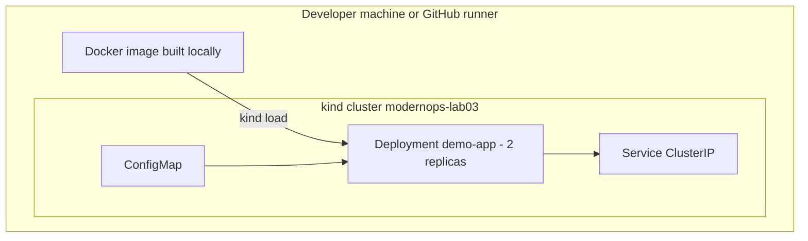

# Lab 03 -- Kubernetes Application Platform

Runs a small real application in a real (temporary) Kubernetes cluster,
provisions it with Terraform, proves it is healthy, breaks it on purpose,
detects the failure, repairs it and cleans everything up.

## Architecture



Cluster creation and resource provisioning are separate: kind creates the
cluster, Terraform manages only namespaced objects, so `terraform destroy` can
never delete a cluster.

## Hardening and quality gates

- runs as UID 10001, non-root, read-only root filesystem
- seccomp `RuntimeDefault`, all capabilities dropped, no service account token
- liveness `/healthz`, readiness `/readyz`
- requests 25m/32Mi, limits 200m/128Mi

## Deliberate failure

A missing image tag with `imagePullPolicy: Never` produces `ErrImageNeverPull`.
The test asserts that the Deployment does **not** become available and that the
container reports an image error, then the desired state is re-applied and all
tests pass again.

## Run it

```bash
cd labs/03-kubernetes-platform
make lifecycle
```

## Evidence

`evidence/local-kubernetes.json` (CI: workflow artifact) lists cluster creation,
image build/load, apply, healthy tests, fault detection, repair, destroy and
cluster removal.
