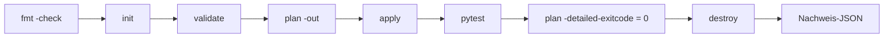

# Lab 01 -- Terraform-Infrastruktur-Lebenszyklus

Zeigt den vollständigen Infrastructure-as-Code-Lebenszyklus in einer
kontrollierten Umgebung: **Format, Validate, Plan, Apply, Outputs, Idempotenz,
Drift-Erkennung, Destroy, Aufräumen** -- ohne Cloud-Ressourcen.

## Was es erzeugt

Vier Dateien in einem git-ignorierten Workspace-Verzeichnis:

| Datei | Modus | Zweck |
| --- | --- | --- |
| `metadata.json` | 0644 | maschinenlesbare Zusammenfassung, Tags, Provider |
| `runtime.conf` | 0644 | mit `templatefile()` gerendert |
| `demo-credential.txt` | 0600 | Dummy-„Secret“ über `local_sensitive_file` |
| `checksums.txt` | 0644 | SHA-256-Manifest |

## Funktionsweise



Das Modul `modules/demo_workspace` hat typisierte, validierte Variablen; ein
falscher `workspace_name` oder ein absoluter `workspace_dir` scheitert an der
Validierung mit klarer Meldung -- beide Fälle sind getestet.

## Ausführen

```bash
cd labs/01-terraform-lifecycle
make lifecycle
```

## Nachweis

`evidence/local-lifecycle.json` erfasst 11 Checks, den Commit und bekannte
Einschränkungen. Ein echtes Beispiel ist in
[`evidence/examples/`](https://github.com/tatics-ug/modern-ops-showcase/tree/main/evidence/examples)
committet.

## Hinweise

- Terraform und OpenTofu funktionieren beide (`make TF=tofu lifecycle`); der
  Wechsel der Engine überschreibt die committete Lock-Datei, was dokumentiert ist.
- Der State ist lokal und git-ignoriert. Er enthält den Dummy-Wert mit sensiblen
  Daten im Klartext -- das ist der Lerneffekt, kein Unfall.

---

*Deutsche Fassung; maßgeblich ist die englische Originalfassung. Die Übersetzung kann hinter der englischen Version zurückliegen.*
