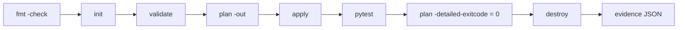

# Lab 01 -- Terraform Infrastructure Lifecycle

Demonstrates the complete Infrastructure-as-Code lifecycle in a controlled
environment: **format, validate, plan, apply, outputs, idempotency, drift
detection, destroy, cleanup** -- with no cloud resources.

## What it creates

Four files in a git-ignored workspace directory:

| File | Mode | Purpose |
| --- | --- | --- |
| `metadata.json` | 0644 | machine-readable summary, tags, provider |
| `runtime.conf` | 0644 | rendered with `templatefile()` |
| `demo-credential.txt` | 0600 | dummy "secret" via `local_sensitive_file` |
| `checksums.txt` | 0644 | SHA-256 manifest |

## How it works



The module `modules/demo_workspace` has typed, validated variables; a wrong
`workspace_name` or an absolute `workspace_dir` fails validation with a clear
message -- both cases are tested.

## Run it

```bash
cd labs/01-terraform-lifecycle
make lifecycle
```

## Evidence

`evidence/local-lifecycle.json` records 11 checks, the commit and known
limitations. A real example is committed in
[`evidence/examples/`](https://github.com/tatics-ug/modern-ops-showcase/tree/main/evidence/examples).

## Notes

- Terraform and OpenTofu both work (`make TF=tofu lifecycle`); switching engines
  rewrites the committed lock file, which is documented.
- State is local and git-ignored. It contains the dummy sensitive value in
  plaintext -- that is the teaching point, not an accident.
